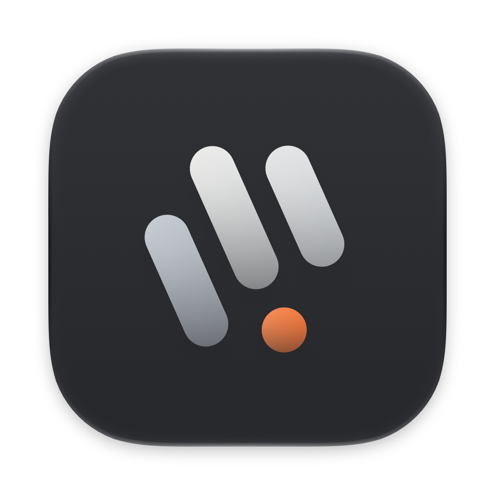
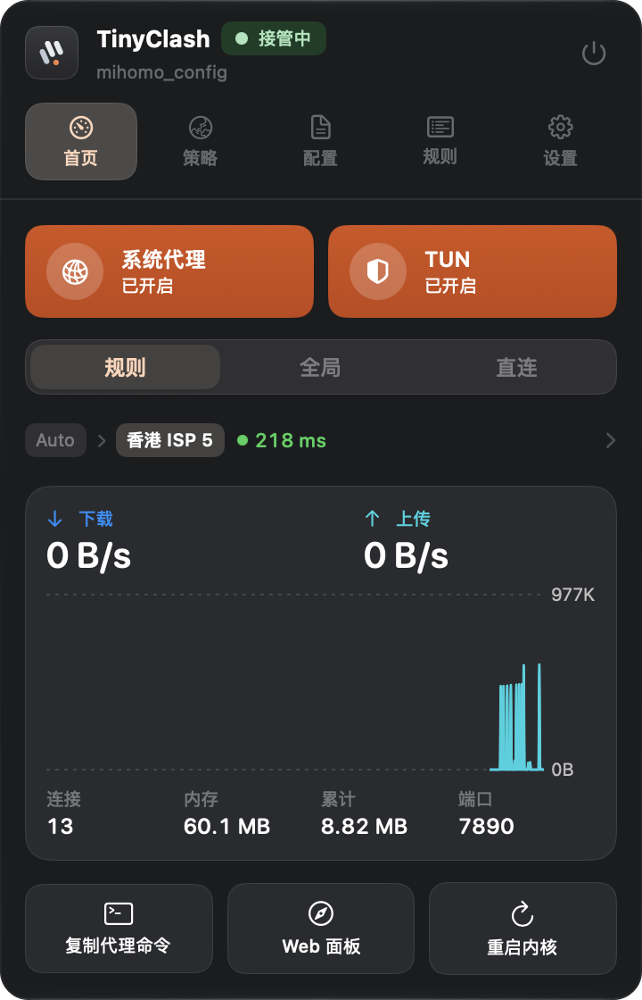
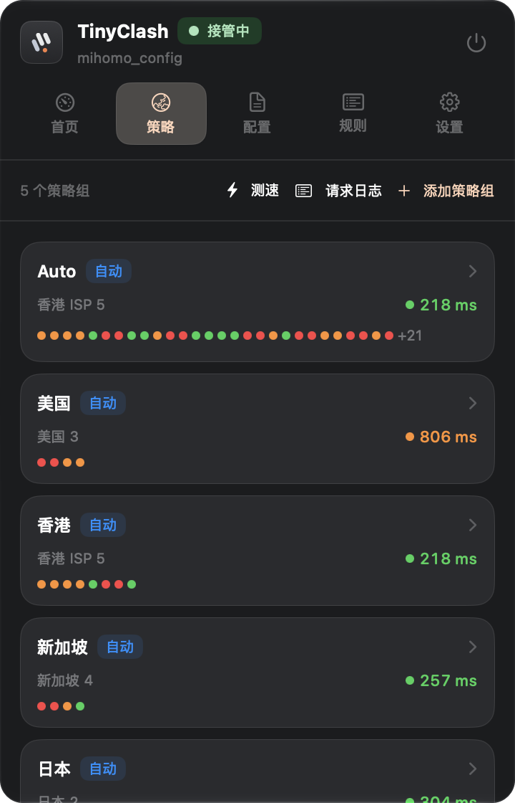
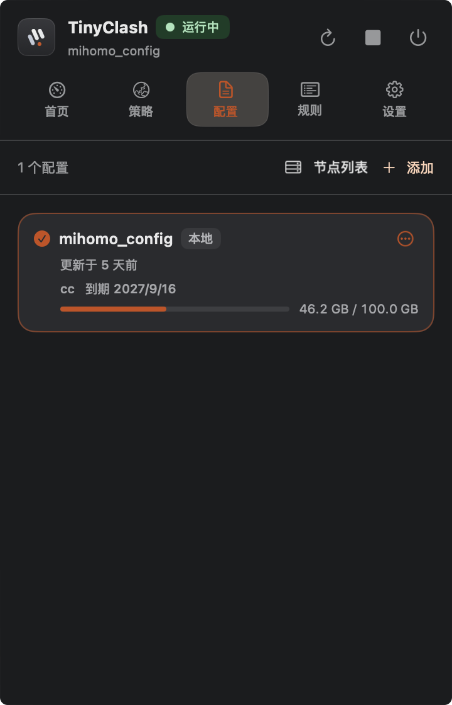
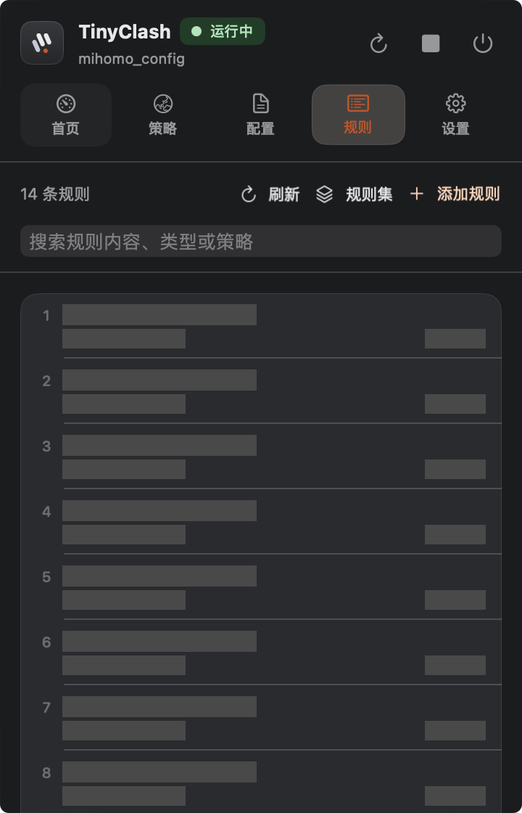
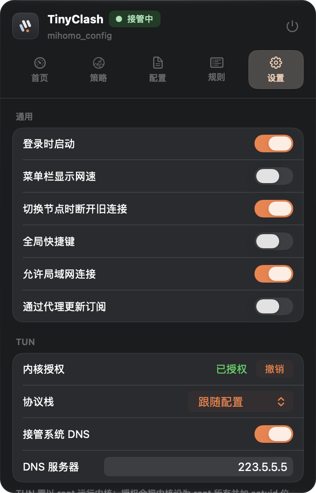

<p align="center">
  
</p>

<h1 align="center">TinyClash</h1>

基于 [mihomo](https://github.com/MetaCubeX/mihomo) 内核的 macOS 菜单栏代理客户端（SwiftUI，macOS 14+）。

## 截图

| 首页 | 策略 | 配置 | 规则 | 设置 |
| :---: | :---: | :---: | :---: | :---: |
|  |  |  |  |  |

## 功能

### 首页

- 一键开关**系统代理**和 **TUN**，切换**规则 / 全局 / 直连**模式
- 一眼看清当前出站路径：模式 → 策略组 → 节点 · 延迟
- 实时流量图，以及连接数、内存、累计流量、端口
- 实时显示当前占用网速最大的四个进程（下载 / 上传）
- 顶部栏直接展示本地代理地址（`127.0.0.1:端口`）并一键复制终端代理命令，支持重启 / 启停内核

### 策略

- 浏览策略组，查看当前节点和延迟，进入分组选择节点
- 单个节点或整组测速，按延迟排序
- 在面板内添加、编辑、删除策略组，直接写入配置文件
- **请求日志**：查看最近连接的目标地址、命中规则、完整策略链和最终出站，支持搜索

### 配置

- 添加订阅，显示已用流量和到期时间，后台自动更新
- 支持 `clash://install-config?url=…` 一键导入
- 导入本地 YAML、新建空白配置、在外部编辑器中编辑后重载
- 单独更新本地配置引用的节点订阅（HTTP `proxy-providers`）
- 识别本地修改过的订阅，覆盖或删除前自动备份

### 规则

- 按匹配顺序查看内核当前加载的规则
- 点击 `RULE-SET` 规则，在编辑页下方查看规则集包含的全部规则，支持搜索
- 在面板内添加、编辑、删除规则，新规则可插到最前面或兜底 `MATCH` 之前
- **规则集**管理：新增、编辑、删除远程 / 本地 / 内联规则集，新增时可同时生成对应的 `RULE-SET` 规则；查看条目数，单独或批量更新

### 设置

- 颜色模式切换：跟随系统 / 黑暗 / 明亮
- 登录时启动与检查更新
- 全局快捷键：⌃⌥⌘S 系统代理、⌃⌥⌘T TUN、⌃⌥⌘M 切换模式
- TUN 授权、协议栈与 DNS 设置
- 绕过地址、测速地址
- 内核管理，更新规则集 / 代理集合 / Geo 数据库，清空 DNS 缓存

### 其他

- 所有配置修改都先经过 `mihomo -t` 校验，失败时不改动原文件；校验通过后自动热重载配置
- 网络切换、睡眠唤醒后自动补齐系统代理设置；被其他程序改掉时会提示
- 内核意外退出时自动清除系统代理、发送通知，并自动重启

## 构建

```bash
./scripts/build-app.sh
open build/TinyClash.app
```

依赖版本（mihomo、Geo 数据）在 [`dependencies.conf`](dependencies.conf) 中配置。
